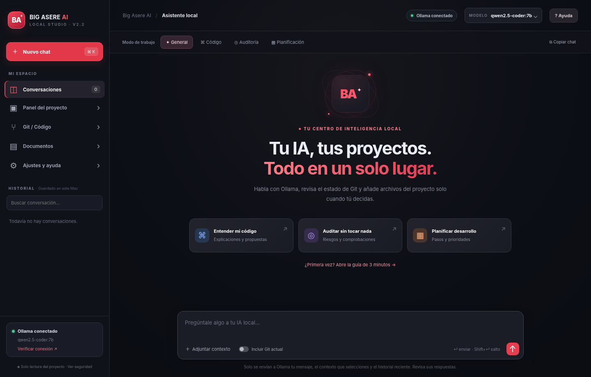

# Big Asere AI · Local Mac Assistant

[Leer en español](#español) · [Read in English](#english)

> **Public review candidate · v2.2.1.** This is the **source code** of a prototype, **not** a signed or notarized macOS installer. First review the security notes, choose a software license, and test the project on macOS before announcing a public release.

## Español

**Big Asere AI** es una aplicación experimental para macOS que se conecta a modelos locales de [Ollama](https://ollama.com). Incluye chat en español, historial, cuatro modos de asistencia, consulta de archivos seleccionados, estado básico de Git y una guía de uso.

### Estado real del proyecto

- ✅ Compilación en **Xcode 26.2** confirmada manualmente en una MacBook Air Apple M2, macOS 26.2.
- ✅ Ventana de la aplicación y **una respuesta real de Ollama** verificadas manualmente.
- ✅ Pruebas de API y restricciones locales con **Ollama simulado** (ver `tests/`).
- ⚠️ La integración completa de documentos, Git y todos los controles requiere más pruebas en macOS.
- ⚠️ No es un producto auditado por terceros ni un instalador firmado/notarizado.

### Requisitos

- Mac con macOS 12 o posterior para el proyecto base; la versión verificada fue macOS 26.2.
- Xcode (verifica compatibilidad con tu versión de macOS).
- Python 3 ejecutable en `/opt/homebrew/bin/python3`, `/usr/local/bin/python3` o `/usr/bin/python3`.
- Ollama instalado y funcionando, con al menos un modelo descargado.
- El modelo predeterminado `qwen2.5-coder:7b` puede no ser adecuado para equipos con poca RAM: selecciona otro instalado en Ajustes.

### Cómo probar en tu Mac

1. Descarga el código fuente desde el repositorio o una versión etiquetada.
2. Abre `BigAsereAI.xcodeproj` con Xcode.
3. Comprueba el esquema **Big Asere AI** y destino **My Mac**.
4. Pulsa **⌘B** para compilar y **⌘R** para ejecutar.
5. Abre Ollama; en la app entra en **Ajustes y ayuda**, verifica el estado y selecciona un modelo instalado.
6. Para un proyecto, elige expresamente la carpeta desde la interfaz. La aplicación no escribe en el proyecto seleccionado.

### Qué hace y qué no hace

**Sí:** chat local con Ollama, historial local, lectura selectiva de ciertos archivos de texto, estado Git en modo lectura, ayuda y diagnóstico.

**No:** no edita archivos del proyecto, no hace `push`, no despliega, no ejecuta código sugerido ni conecta servicios en la nube por sí sola. No integra automáticamente scripts privados anteriores.

### Datos y privacidad

El historial y configuración se guardan en `~/Library/Application Support/Big Asere AI/state.json` **en tu propia Mac**. Este archivo **no forma parte del repositorio**. El servidor auxiliar escucha en `127.0.0.1`, utiliza una sesión aleatoria y envía preguntas al Ollama local. Antes de seleccionar carpetas, revisa que no contengan secretos: el filtro es preventivo, no infalible.

**No subas a GitHub tus chats, la carpeta de soporte de aplicación, credenciales, repositorios de empresa ni modelos privados.** Ve [SECURITY.md](SECURITY.md).

### Estructura

- `BigAsereAI/BigAsereApp.swift` — ventana macOS y arranque del servidor auxiliar.
- `BigAsereAI/Resources/` — interfaz HTML/CSS/JS, servidor Python local e icono.
- `BigAsereAI.xcodeproj/` — proyecto de Xcode.
- `tests/` — pruebas locales del servidor y UI con simulaciones.
- `VISTA_PREVIA/` — capturas generadas con datos de prueba.

### Contribución, licencia y publicación

Antes de publicar este borrador, el propietario debe **elegir y aprobar la licencia**. Consulta [`LICENSE_DECISION.md`](LICENSE_DECISION.md). Sin licencia explícita, la presencia en GitHub **no implica permiso de reutilización libre**.

No publiques binarios precompilados como «instalador seguro». Para distribución general es recomendable firmar y notarizar con Apple. Para desarrollo local, compila desde la fuente con Xcode.

---

## English

**Big Asere AI** is an experimental macOS front-end for locally installed [Ollama](https://ollama.com) models. Features: local chat and history, four assistant profiles, selected text-file context, read-only Git status, and a Spanish help panel.

**Verified:** successful Xcode 26.2 build and one real local Ollama reply on an Apple M2 MacBook Air. Automated backend/UI checks use a mock Ollama. Remaining interactions have not been fully validated on macOS. **This is source code, not a signed app**.

**Quick start:** install compatible Xcode, Python 3, and Ollama with a downloaded model; open `BigAsereAI.xcodeproj`, build (`⌘B`) and run (`⌘R`). Confirm the Ollama connection in Settings before chatting. The project folder picker provides read-only access to selected compatible files; do not select directories containing secrets.

**Privacy:** runtime state stays in `~/Library/Application Support/Big Asere AI/state.json` on your machine and must never be committed. This app has **not** had an independent security audit. See [SECURITY.md](SECURITY.md) and [LICENSE_DECISION.md](LICENSE_DECISION.md) before redistribution.
